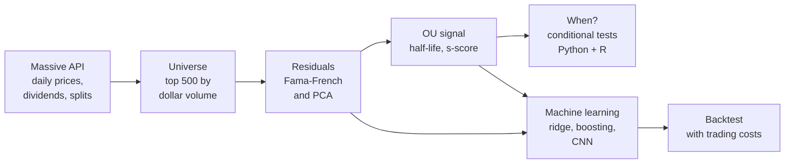
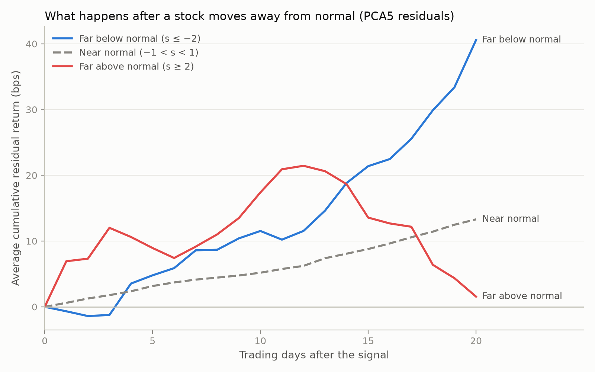
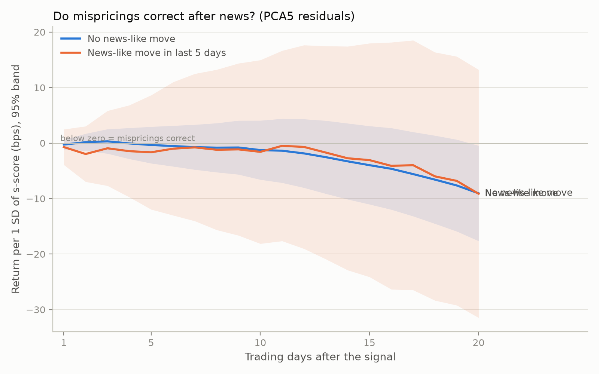
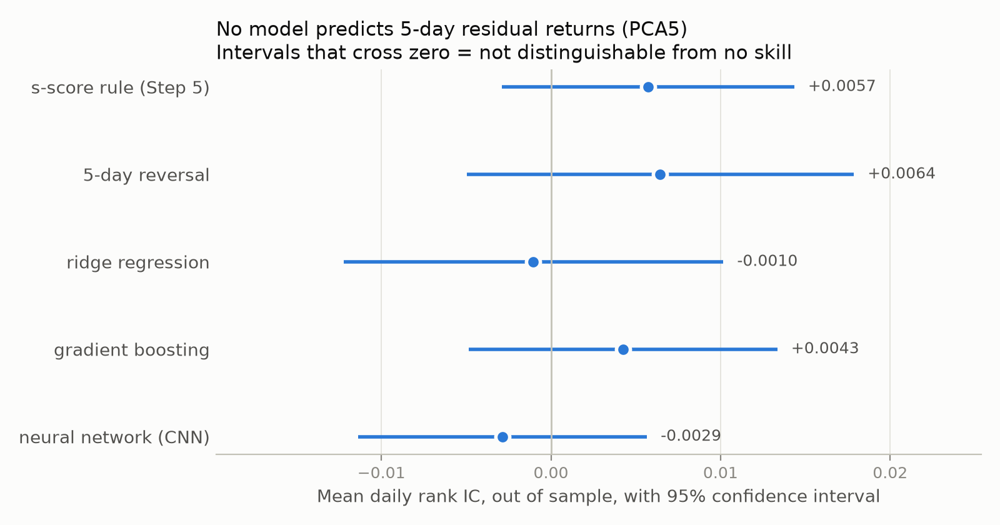
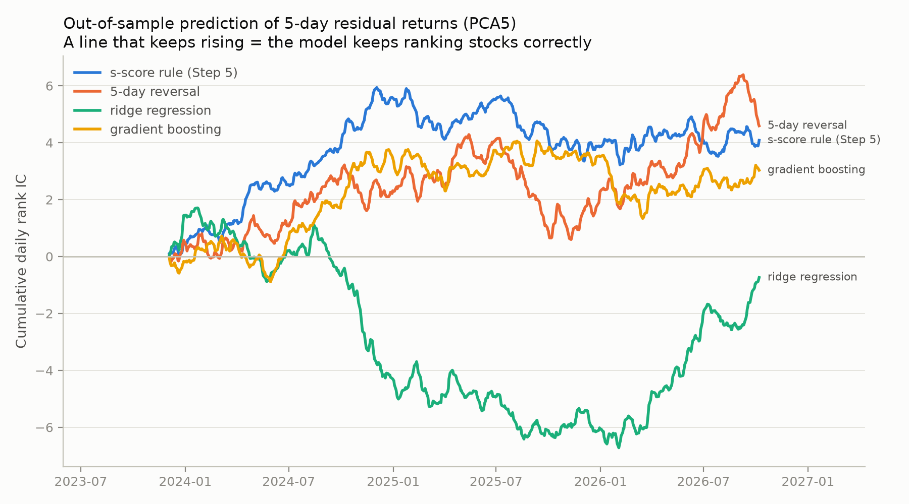
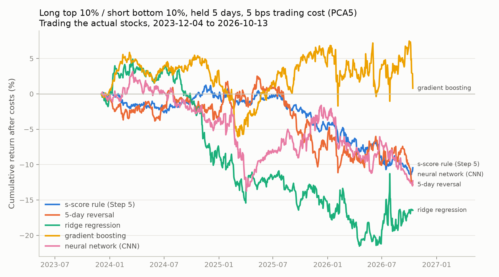

# When Do Stock Mispricings Correct? A Statistical Arbitrage Study

**Daniel Eichel** · October 2026

---

## Abstract

Statistical arbitrage assumes that when a stock moves away from similar stocks, the gap tends to close. This study tests that assumption on the 500 most heavily traded US stocks each month from October 2021 to October 2026. Each stock's idiosyncratic ("residual") return is isolated with out-of-sample Fama-French and PCA factor models, and five ways of predicting its correction are compared: the classical Ornstein-Uhlenbeck (OU) mean-reversion signal, a 5-day reversal rule, ridge regression, gradient boosting, and a convolutional neural network that reads the raw 30-day residual path.

The answer is that mispricings in these stocks do not reliably correct over this period. Fitted OU half-lives (median 4.2 days) are indistinguishable from those of simulated random walks. The OU signal does not predict residual returns on average, and no subgroup (news vs. no news, company size, sector, market stress, year) shows a correction that survives a multiple-testing correction in both factor models; a second estimation method in R agrees on 92–93% of tests. In walk-forward out-of-sample tests from December 2023 to October 2026, no model, including the neural network, ranks stocks better than chance; the 95% confidence intervals rule out a rank information coefficient (IC) above about 0.018. Long-short portfolios built on these signals earn returns near zero before costs and lose money after realistic trading costs (5 basis points), with break-even costs of at most about 6 bps.

---

## 1. Question and motivation

Some stocks usually move together: two large banks, two chip makers, a stock and its industry. Statistical arbitrage bets that when one of them drifts away from its group for reasons specific to that stock, the drift will reverse. This is one of the oldest quantitative trading ideas. A 2024 Stanford study (see References) decomposes it into three steps (build residual portfolios, extract a signal, decide how to trade) and finds that the signal step matters most, with deep learning far outperforming the classical OU model on 1998–2016 data.

This project asks four questions about a more recent period, using data the author collected:

1. **How fast** do stock-specific mispricings correct?
2. **When** do they correct faster or slower: after news or not, for smaller or larger companies, by sector, in calm or stressed markets?
3. **Which signal** predicts corrections best: the classical OU model, simple rules, linear and tree-based machine learning, or a neural network?
4. **Could an investor profit** after trading costs?

---

## 2. Data

**Source.** Daily open, high, low, close and volume for every US-listed security were downloaded from the [Massive](https://massive.com) API (formerly Polygon.io) for 1,250 trading days, 21 October 2021 to 14 October 2026: 13.9 million rows. The download includes 6,651 tickers that were later delisted, so the sample does not suffer from survivorship bias. Dividends (237,073 records), stock splits (6,548), and each company's market value and industry code as of every month end were also collected. Daily Fama-French five-factor returns come from the Kenneth French Data Library (available through 31 August 2026).

**Returns.** Prices are split-adjusted. Daily total return includes dividends on the ex-dividend date: (close + dividend) / previous close − 1. A return is computed only when the stock also traded on the previous trading day.

**Universe.** Each month, the study uses the 500 common stocks with the highest average daily dollar volume in the *previous* month, among stocks that traded every day of that month and closed at $5 or more. Choosing with last month's data prevents look-ahead bias. This yields 59 monthly universes (December 2021 to October 2026), 1,199 distinct stocks, about 51 new entrants per month, and 609,998 stock-days. The median company has a market value of $37 billion at the start and $48 billion at the end, so these are large, well-known firms.

**Quality checks.** Inside the universe, only 6 stock-day returns are missing (0.001%). Every daily move larger than 50% (27 cases) was checked. Two were artifacts of corporate actions that price data cannot represent, and their returns were removed with a documented reason (`config/return_corrections.csv`):

- Biohaven, 4 October 2022 (acquisition by Pfizer with a spin-off that kept the ticker)
- Corteva, 1 October 2026 (spin-off of its seed business)

The other 25 are real events, for example the March 2023 bank failures (Silicon Valley Bank −60%, First Republic −62%) and Moderna's +177% on 19 August 2026 after a successful late-stage cancer vaccine trial. Market value is available for 100% of stock-months and industry codes for 96.5%.

---

## 3. Methods

### 3.1 Pipeline

### 3.2 Residual returns

A stock's daily return is split into a part explained by common factors and a residual specific to the stock. Two families of factor models are used, both strictly out of sample:

- **Fama-French** (1, 3 and 5 factors): each stock's betas are estimated on the previous 60 trading days, and the residual on day *t* is the actual return minus betas × that day's factor returns.
- **PCA** (1, 3, 5 and 10 factors): each day, statistical factors are re-estimated from the correlation matrix of the previous 252 trading days (eigenportfolios), and betas on the previous 60 days.

**A robustness problem and its fix.** With ordinary least-squares betas, the pooled share of variance explained *fell* as factors were added and turned negative for PCA-10 (−11%), even though the fit inside each window improved. For the median stock, however, more factors always helped, which showed the cause was not overfitting but a few extreme return days (for example meme-stock spikes) producing absurd betas. Winsorizing returns at the median ± 5 robust standard deviations **only for beta estimation** fixed this: pooled out-of-sample variance explained rises smoothly (PCA-10: from −11% to 31%), and the residuals themselves always use actual returns.

| Model | Variance explained, median stock | Average correlation between stocks |
|---|---|---|
| Raw returns | — | 0.098 |
| Fama-French 1 | 23.0% | 0.033 |
| Fama-French 3 | 26.8% | 0.022 |
| Fama-French 5 | 28.1% | 0.015 |
| PCA 1 | 21.0% | 0.018 |
| PCA 3 | 31.7% | 0.001 |
| PCA 5 | 34.7% | −0.001 |
| PCA 10 | 36.1% | −0.001 |

*Out-of-sample, winsorized betas. Correlations: last 252 common trading days (29 Aug 2025 – 31 Aug 2026), 343 stocks.*

About five factors are enough: PCA-5 removes essentially all co-movement between stocks, and PCA-10 adds little. **PCA-5 is the main model; Fama-French 5 is the second.**

### 3.3 The mean-reversion signal

For each stock-day, the last 30 days of residual returns are summed into a residual "price" path *X* and an AR(1) model, the discrete-time Ornstein-Uhlenbeck process, is fitted: X[l+1] = a + b·X[l] + ε. A path is mean-reverting if 0 < b < 1, with **half-life** −ln 2 / ln b. The **s-score** (X_today − μ) / σ_eq measures how far the stock is from its long-run level in equilibrium standard deviations.

**Small-sample bias.** A 30-day AR(1) estimate of *b* is biased downward, so even a pure random walk often looks mean-reverting. To test against that, 200,000 random walks of the same length were simulated. A stock-day counts as significant mean reversion only if its *b* is below the random walk's 5% critical value (b < 0.577), the same idea as the Dickey-Fuller test, by simulation.

### 3.4 Testing whether the signal predicts corrections

Each day, the next *h* = 1, 5, 10 or 20 days' residual return is regressed on the s-score across stocks (Fama-MacBeth). Daily slopes are averaged and tested with **Newey-West** standard errors, which correct for overlapping multi-day returns. A negative slope means mispricings correct. Everything known at the close of day *t* forms the signal; outcomes use days *t*+1 onward only.

For the "when" question, the same test is run within groups: a news-like move in the last 5 days (a residual move of at least 3 standard deviations on at least twice the usual volume), company size terciles, ten sectors, calm/normal/stressed markets, whether the OU fit was significant, and year. About 100 tests per factor model are controlled with the **Benjamini-Hochberg** false discovery rate. As a second method, the tests were re-estimated **in R** (`fixest`) as panel regressions with day fixed effects and standard errors clustered by stock and by day.

### 3.5 Machine learning and the neural network

Four prediction models compete with the s-score rule on the same out-of-sample stock-days, all predicting the next 5 days' residual return:

- **5-day reversal:** minus last week's residual return (no fitting)
- **Ridge regression** and **gradient boosting** (histogram-based, scikit-learn) on 27 features: the residual path over 1–30 days (raw and volatility-scaled), the OU fit, volatility, raw returns, volume, a news-like flag, company size, sector, and market conditions
- **Convolutional neural network (PyTorch)** reading the raw 30-day path (3 channels: scaled daily residual, cumulative path, log volume ratio); an ensemble of 3 networks with early stopping

**Walk-forward validation.** Hyperparameters were chosen once, on the first 12 months only. Then, each quarter, every model is trained on all earlier data and predicts that quarter. A 5-day embargo ensures no training target overlaps the test period. Performance is measured by the daily **rank information coefficient (IC)**, the cross-sectional rank correlation between prediction and outcome that is standard in quantitative investing, with Newey-West t-statistics and 95% confidence intervals.

### 3.6 Backtest

Each day, each model's predictions are turned into a dollar-neutral portfolio: long the top 10% and short the bottom 10%, equal weights, gross exposure 1. Each day's picks are held for 5 days (overlapping portfolios). Profit is earned on the next day's returns. Trading costs of 0, 5 and 10 bps per dollar traded are subtracted, 5 bps being the assumption used in the reference study. Returns are regressed on the Fama-French five factors to check for hidden factor exposure.

### 3.7 Validating the code

Every analysis step was tested on simulated data before being run on real data: a **null test** (pure noise, where every model must find nothing, confirming there is no look-ahead) and a **planted test** (a known pattern that the method must recover). The R script and the neural network both run a self-test on simulated data at start-up and stop if they fail. For example, the network must learn a non-linear pattern that a linear model cannot see (network IC 0.448 vs. linear 0.007; best possible 0.469). These tests also caught several real bugs during development.

---

## 4. Results

### 4.1 How fast do mispricings correct? Indistinguishable from a random walk

| | PCA-5 residuals | FF-5 residuals | Simulated random walk |
|---|---|---|---|
| Stock-days fitted | 423,322 | 494,265 | 200,000 |
| Looks mean-reverting (0 < b < 1) | 95.3% | 95.1% | 95.0% |
| Significant at 5% | 6.1% | 5.8% | 5.0% (by construction) |
| Median half-life | 4.2 days | 4.3 days | 4.3 days |

The fitted half-life of "about 4 days" is not a property of the stocks: pure random walks produce the same number. Only slightly more stock-days than chance pass the significance test, and the pattern is the same in every year from 2022 to 2026.

The forward-return test agrees. For PCA-5, the slope of future residual returns on the s-score is not significant at 1, 5 or 10 days (t between −0.41 and −0.17); at 20 days it is −8.8 bps per standard deviation (t = −2.15), one of eight tests, which does not survive a multiple-testing correction and does not appear for FF-5 (t = −0.17). The spread between the most "too low" (s ≤ −2) and most "too high" (s ≥ 2) stocks is not significant at any horizon. On day 1 it even points the wrong way: stocks far above normal kept rising (+6.9 bps, t = 2.64).

### 4.2 When do they correct? No reliable situation

The hypothesis that news-driven moves keep going while moves without news reverse was **not supported**: the two groups behave the same (differences: t from −1.36 to +0.35 across models and horizons). No size, sector, market-stress, OU-fit or year group shows a correction that is significant after the false-discovery-rate correction in *both* factor models. With about 100 tests per model, roughly 5 should exceed |t| = 2 by chance alone; about 10 did for PCA-5 and fewer for FF-5, mostly at the 20-day horizon.

Only two Fama-MacBeth results survived the correction, both for PCA-5 only: the "Unknown" sector at 1 day (stocks without an industry code, t = −3.49) and the year 2024 at 5 days (t = −3.49). The R panel regressions, which weight every stock-day equally, find **no** result significant after the correction in either model, and the Unknown-sector effect drops to t = −0.90, suggesting it came from a few days on which that small group had few stocks. Overall, the two methods reach the same conclusion on **93% (PCA-5) and 92% (FF-5)** of tests. Apart from the Unknown sector, every disagreement involves t-statistics between 1.3 and 2.9 under both methods, close to the |t| = 2 cutoff, and none is significant after the correction under either method.

### 4.3 Can machine learning find what the OU model missed? No

Out-of-sample, 4 December 2023 to 14 October 2026 (713 days, 297,845 stock-days, PCA-5 residuals):

| Model | Mean rank IC | 95% CI | t-stat | Days IC > 0 | Top − bottom 10%, 5 days |
|---|---|---|---|---|---|
| s-score rule | +0.0057 | [−0.003, +0.014] | 1.30 | 56% | +5.3 bps (t = 0.78) |
| 5-day reversal | +0.0064 | [−0.005, +0.018] | 1.11 | 52% | +6.8 bps (t = 0.51) |
| Ridge regression | −0.0010 | [−0.012, +0.010] | −0.18 | 49% | −13.6 bps (t = −1.07) |
| Gradient boosting | +0.0043 | [−0.005, +0.013] | 0.92 | 51% | +17.9 bps (t = 1.65) |
| Neural network (CNN) | −0.0029 | [−0.011, +0.006] | −0.66 | 49% | −4.1 bps (t = −0.35) |

Every confidence interval contains zero, and every upper limit is at most 0.018, so a signal of the strength used by many practitioners (IC of a few hundredths) can be ruled out. Several diagnostics point the same way:

- When tuning on the first year, ridge regression chose the strongest shrinkage available, pulling predictions toward zero.
- Out-of-sample R² was slightly negative for both fitted models.
- Quarterly ICs changed sign repeatedly.
- The neural networks were often stopped by early stopping after one or two training passes, meaning further training made validation results worse: they were learning noise.
- The most flexible models did not beat the one-line rules.

The cumulative-IC chart shows each model's skill wandering like a random walk. The s-score rule's positive stretch in 2024 matches the 2024 subgroup result above but did not persist; because it was noticed after looking at the data, it is reported as an observation, not a finding.

### 4.4 Could an investor profit? No

Long top 10% / short bottom 10%, held 5 days, trading the actual stocks, 4 December 2023 to 13 October 2026:

| Model | Annual return, no costs | Annual return, 5 bps | Sharpe, 5 bps | Max drawdown, 5 bps | Break-even cost | Daily turnover |
|---|---|---|---|---|---|---|
| s-score rule | +0.5% | −3.8% | −0.96 | −12.5% | 0.6 bps | 34% |
| 5-day reversal | −0.2% | −4.6% | −0.68 | −15.0% | < 0 | 35% |
| Ridge regression | −2.5% | −5.9% | −0.61 | −25.2% | < 0 | 27% |
| Gradient boosting | +3.6% | +0.7% | 0.08 | −11.3% | 6.1 bps | 23% |
| Neural network | −0.7% | −4.3% | −0.58 | −16.4% | < 0 | 28% |

Before costs, no strategy's mean return is distinguishable from zero (t between −0.47 and 0.71). After 5 bps, four of five lose money. Gradient boosting comes out on top, but its result is not significant (t = 0.13 after costs), and it was identified as best only after comparing five strategies, so it should be read as luck. Even under the optimistic assumption of trading the residuals with free perfect hedging, the best gross Sharpe ratio is 0.91 (t = 1.56).

The Fama-French regression confirms that the portfolios are built as intended: market betas are near zero (−0.04 to +0.03), R² is about 1%, and no annualized alpha is significant (|t| ≤ 1.07).

The machine-learning portfolios are about twice as volatile as the s-score portfolio (8.8% vs. 4.0% a year). Because those models predict returns in percent, the most volatile stocks receive the most extreme predictions and fill the top and bottom deciles. The s-score is already scaled by each stock's volatility.

---

## 5. Discussion

Across five steps and five models, the evidence points one way: for large, heavily traded US stocks in 2022–2026, deviations of a stock from its factor-implied behavior do not reliably reverse over 1 to 20 days, and the tested signals cannot be traded profitably.

**Comparison with the reference study.** On 1998–2016 data, the reference study reports Sharpe ratios of roughly 0.2–1.2 before costs for the OU-threshold model and up to about 4 for its CNN-Transformer. Here, the s-score rule reaches 0.12 and the neural network −0.10 before costs. The data, period, universe and model designs differ, so this is not a test of that study's results. It is consistent with the view that this kind of opportunity in the most liquid US stocks has largely been competed away, or requires much better models, larger data and lower costs than a public-data study has.

**What "no effect" means here.** A non-significant result is not proof of zero. The confidence intervals give the useful statement: over this period, any correctable mispricing in these stocks is too weak to detect with three years of daily data (rank IC below about 0.018) and too weak to cover realistic trading costs.

---

## 6. Robustness

- **Two factor models** (PCA-5 and Fama-French 5) give the same conclusions throughout.
- **Two estimation methods** (Fama-MacBeth in Python, clustered panel regressions in R) agree on 92–93% of conditional tests.
- **Multiple testing** is controlled with Benjamini-Hochberg q-values; no conditional effect is significant in both models.
- **Random-walk benchmark** for OU half-lives guards against small-sample bias.
- **Robust beta estimation** (winsorized) is compared with ordinary least squares.
- **Code validation** on simulated null and planted data for every step, plus built-in self-tests in the R script and the neural network.

---

## 7. Limitations

- **Short sample.** Five years of data (the limit of the data plan), and about three years out of sample, limit statistical power; the conclusions cover 2022–2026 only.
- **Universe by trading volume.** Ranking by dollar volume admits some volatile "meme" stocks; the reference study ranks by market value.
- **Corporate actions.** Spin-offs had to be corrected by hand; other undetected corporate actions or ticker changes could affect a few returns. Stocks are identified by ticker.
- **News proxy.** "News-like move" is approximated from returns and volume; no actual news data was used.
- **Market stress groups** use full-sample volatility terciles; this describes when corrections happen but is not a trading rule.
- **Models.** The neural network is small and trained to minimize squared error rather than the reference study's Sharpe-ratio objective; the machine-learning portfolios rank raw-return predictions, which concentrates positions in volatile stocks.
- **Costs.** A linear 5 bps cost ignores market impact and short-borrowing fees, so real results would be worse.
- **Factor data** ends on 31 August 2026, so Fama-French residuals and the alpha regression stop there.

---

## 8. Conclusion

Do stock mispricings correct? For the 500 most-traded US stocks from 2022 to 2026, not detectably. Classical mean-reversion half-lives match those of random walks; no market condition reliably produces corrections; neither linear models, gradient boosting nor a neural network predicts residual returns out of sample; and trading on these signals loses money after realistic costs. The project's main contribution is the method: a survivorship-bias-free data pipeline, strictly out-of-sample estimation, a simulation benchmark for half-lives, multiple-testing control, cross-checks in two languages, and validation of every step on simulated data. That process is what makes a negative result credible.

---

## Reproducing this study

Code is in `src/` (steps 01–09, numbered in order; `06b` is the R check). Massive data is licensed for personal use and is not included. A Massive Stocks plan with five years of history is required to rerun step 01. See the README for commands.

---

## References

- Guijarro-Ordonez, J., Pelger, M., and Zanotti, G. (2024). Deep Learning Statistical Arbitrage. Working paper, Stanford University. SSRN 3862004.
- Avellaneda, M., and Lee, J.-H. (2010). Statistical arbitrage in the US equities market. *Quantitative Finance*, 10(7), 761–782.
- Fama, E. F., and French, K. R. (2015). A five-factor asset pricing model. *Journal of Financial Economics*, 116(1), 1–22.
- Fama, E. F., and MacBeth, J. D. (1973). Risk, return, and equilibrium: Empirical tests. *Journal of Political Economy*, 81(3), 607–636.
- Newey, W. K., and West, K. D. (1987). A simple, positive semi-definite, heteroskedasticity and autocorrelation consistent covariance matrix. *Econometrica*, 55(3), 703–708.
- Benjamini, Y., and Hochberg, Y. (1995). Controlling the false discovery rate. *Journal of the Royal Statistical Society, Series B*, 57(1), 289–300.
- Dickey, D. A., and Fuller, W. A. (1979). Distribution of the estimators for autoregressive time series with a unit root. *Journal of the American Statistical Association*, 74(366), 427–431.
- Data: Massive (formerly Polygon.io) Stocks API; Kenneth R. French Data Library.
